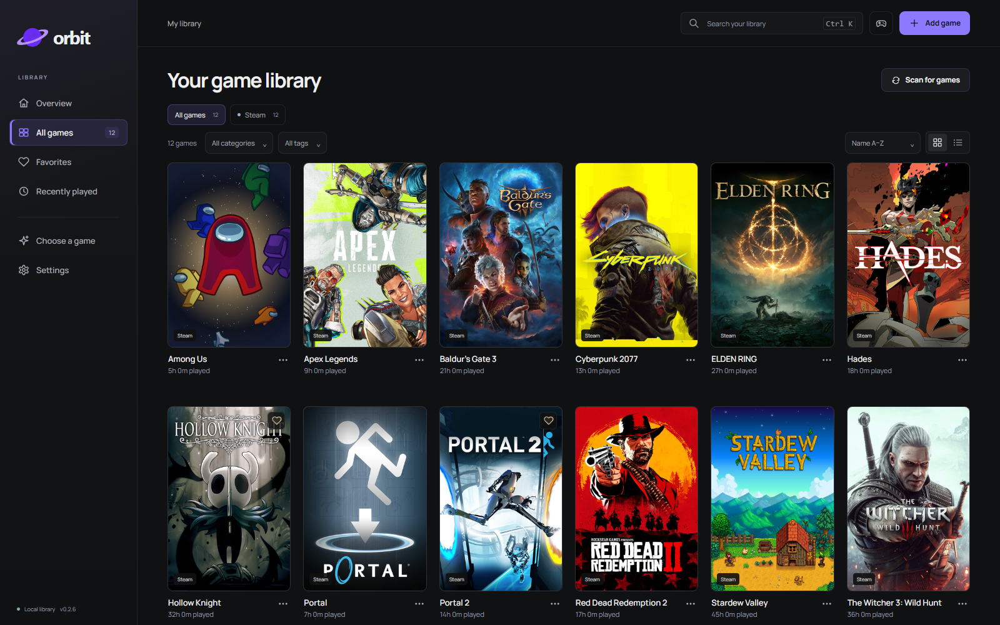
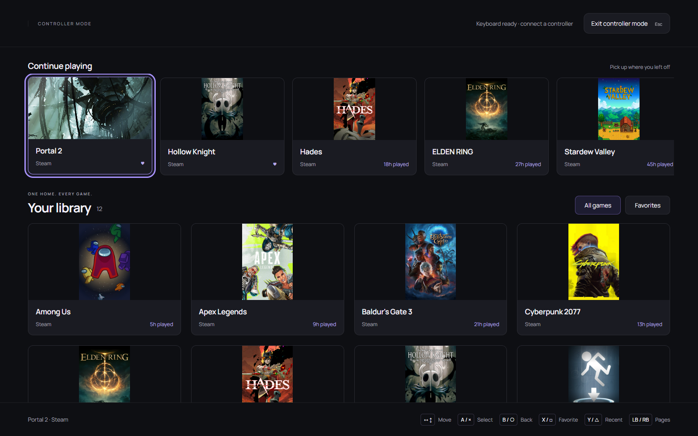

# Orbit Game Launcher

**Your games. One library. Less clutter.**

Orbit is a local-first desktop game launcher for finding, organizing, and playing installed games. It brings games from different storefronts into one library without replacing their launchers or moving their files.

**Orbit 0.2.11 is Rust-first on Windows:** the standalone **Rust + Tauri 2 preview** is the recommended edition to try, using Orbit's familiar interface with a native Rust backend. The Rust build is still **experimental and unsigned** while installed Windows acceptance is incomplete. **Electron remains available as the fallback** and is not being removed.

**[Download the latest Windows release](https://github.com/j5bak928-a11y/orbit-game-launcher/releases/latest)** — look for the separately named **Orbit Rust Preview 0.2.11** NSIS installer (recommended Windows download), MSI or portable ZIP, and **Orbit Launcher 0.2.11** Electron setup/portable EXE as a fallback. Check the release tag and file version before installing. [Read the complete changelog](CHANGELOG.md), including the **0.2.7–0.2.10 history** carried into v0.2.11. **Important when upgrading:** choose **Quit Orbit** from the system tray before installing or relaunching; closing the window alone leaves the older Rust process alive and can prevent the newer UI and changelog from opening.



> Screenshots use a sample library, public artwork, and simulated playtime. They are UI previews, not measurements of a real gaming session.

## What Orbit can do

- **One game library:** discover supported Steam, Epic, GOG, Battle.net, Xbox PC and standalone installations, add executables, and organize entries with favorites, tags, categories, and filters.
- **Find games quickly:** search with `Ctrl/Cmd + K`, sort the library, and switch between grid and list views.
- **Ultra fast cold startup: 1s** — observed in a cold-start test performed by the user on their own Windows setup. This is an individual measurement, **not an independently reproduced benchmark or a guaranteed startup time**; results depend on hardware, storage, installed games and the runtime environment.
- **Launch through the right client:** use a game's storefront URI or a validated executable, without moving or modifying game installations.
- **Track playtime:** record supported direct-launch sessions and detect certain externally launched games on Windows. Tracking accuracy depends on how a game starts and which processes can be identified.
- **Show game artwork:** look for validated portrait artwork in bounded neighboring folders, use cached covers and icons offline, optionally look up online artwork, or select your own cover, banner, and icon.
- **Play with a controller:** navigate the fullscreen library and game details with a standard-mapped Xbox or PlayStation controller, including page triggers, right-stick scrolling, reconnect handling and a Menu / Options entry shortcut; keyboard and mouse remain available.
- **Choose your language:** use Orbit in English, Nederlands, Deutsch, Français or Español; follow the system language automatically or select one in Settings. Both desktop editions save this preference locally.
- **See what's new:** the first start of v0.2.11 shows the release highlights for 0.2.11 through 0.2.7. Its narrow rounded scrollbar matches your accent color. The close X aligns with the header; no purple outline surrounds the full window. Dismiss the dialog once per version, or reopen it from the sidebar or Settings. This uses local browser/WebView2 storage, not your game database; restart the actual new executable after fully quitting an older tray process.
- **Review gaming statistics:** recorded-session totals for recent days and weeks, a daily activity chart, recent games and a period-best day. Overlapping records for a single game are deduplicated in reports without rewriting play history.
- **Keep your data local:** store games, settings, and play history in SQLite; export and restore library backups.

<table>
<tr><td></td><td></td></tr>
</table>

## Current editions

| | Rust / Tauri 2 preview | Electron desktop |
| --- | --- | --- |
| Version in this repository | **0.3.2** | **0.3.2** |
| Status | **Rust-first recommended Windows preview**; experimental, installed native acceptance incomplete | **Established fallback**, maintained during the Rust transition |
| UI | Familiar Orbit HTML/CSS/JavaScript in WebView2 | Familiar Orbit HTML/CSS/JavaScript in Electron |
| Backend | Native Rust for library, discovery, tracking, artwork and backups | Node.js/Electron, with a native Windows process helper |
| Windows packaging | NSIS setup, MSI and portable ZIP with runtime DLLs | NSIS setup and portable EXE |
| Game tracking in the tray | Rust keeps running while its WebView2 window is destroyed on close | Continues while the Electron window is hidden |

The editions have **different application IDs and data directories** (`com.orbitlauncher.rustpreview` and `com.orbitlauncher.desktop`). On first launch into an empty Rust profile, the Rust preview can snapshot an existing Electron library and copy compatible artwork without modifying the original database. Changes made later in one edition do **not** automatically sync to the other. Back up both libraries independently, and do not uninstall Electron solely because the Rust preview launches.

## Roadmap: Rust-first Orbit 1.0

**Direction:** starting with **0.2.8**, make the fast, local-first Rust/Tauri preview the **recommended Windows download to try**, then strengthen native reliability and develop library organization, a console-quality controller experience, and optional offline intelligence. Keep Electron as the fallback during the transition; do not sacrifice libraries or playtime history to accelerate a version bump.

These are **engineering milestones, not promises of public binary availability or dates**. Electron and Rust currently use version `0.3.2` in source. Rust-first is a **release/download preference**, not a claim that native Windows parity is proven. Rust `0.2.7` established the preceding reliability groundwork; see the [full changelog](CHANGELOG.md).

| Milestone | Theme | Deliverable / exit criteria |
| --- | --- | --- |
| **0.2.7 — Reliability groundwork** | Protect the foundation | Added complete session-history backups, restore and database migration protections; real installed Windows upgrade, tray recovery and live-game acceptance remain outstanding. |
| **0.2.8 — Rust-first release direction** | Recommended Windows preview | Offer separately identified Rust NSIS/MSI/portable downloads as the first Windows choice, retain Electron setup/portable as a fallback, and keep unsigned-update and native acceptance limitations explicit. |
| **0.2.9 — Tracking and UI fixes** | Reliable game sessions and visible updates | Rocket League anti-cheat helper cannot falsely keep a storefront session running; correct the existing top-left heart's height and accent-colored strokes/fills, keep What's New accessible and include Xbox local-logo recovery from PR #48. Portrait Xbox covers and packaged-only UWP remain future work. |
| **0.2.10 — Focused interface polish** | Cleaner game posters and changelog | Keep selected favorites visible but show unsaved hearts only on hover/keyboard focus (always accessible on touch); restyle the release notes scrollbar with a rounded, accent-colored thumb without disabling scrolling. |
| **0.2.11 — Changelog window polish** | Clear, accessible modal | Align the X control with the header and remove the purple focus ring around the full dialog without removing keyboard focus indicators from the actual controls. |
| **0.3.0 — Native confidence** | Finish Windows parity | Prioritize physical-controller reliability, tray reopen and close behavior, crash/sleep recovery, artwork/discovery accuracy, backup restore and measured background performance. Actual game launches, session tracking and upgrades are already reported working by the user; retain them as regression checks, not unresolved baseline defects. Validate remaining behaviors on representative Windows installations before retiring Electron as the fallback. |
| **0.4.0 — Your Gaming Library** | Organization and personalization | Smart collections (**Currently Playing**, **Backlog**, **Completed**), custom collections, advanced filtering, tags, favorites, per-game launch preferences, and responsive libraries with 5,000+ games. |
| **0.5.0 — Console Experience** | Controller Mode 2.0 | A polished fullscreen/couch interface, immersive game details, robust controller ownership and focus recovery, plus efficient idle gamepad polling. |
| **0.6.0 — Orbit Intelligence** | Useful local insights | Offline playtime insights, activity heatmaps, game suggestions, neglected-backlog prompts and optional milestones. No mandatory accounts, constantly running AI service or new background overhead. |
| **1.0.0 — Orbit Complete** | Stable release | Verified install/upgrade/uninstall, safe migration and full backup round trips, reliable session recovery, accessible polished UI, repeatable performance results and documented limitations. |

**Rules for every release:**

**User-reported Windows acceptance (9 November 2026):** real games launch, playtime sessions are tracked correctly, and Orbit upgrades successfully in the user's tested setup. These are *user-confirmed working flows*, not independently reproduced coverage of every launcher, Windows version, upgrade path or failure-recovery case. Keep regression tests for these three flows, but do not treat them as currently broken or untested in the v0.3.0 roadmap.

1. **Protect performance.** Use the maintainer's observations of roughly **5 MB in tracking-only background use** and **130–180 MB with the UI open** as *reference measurements*, not hard guarantees. Compare whole process trees (including WebView2), startup time, game-launch latency and CPU on matched workloads. Reject unnecessary services, unbounded scans and regressions.
2. **Protect data.** Never silently alter or double-count historical playtime. Test SQLite migrations, backups, restores and crash/sleep recovery using disposable profiles. Do not run separate Electron/Rust trackers against the same game during migration testing without establishing ownership.
3. **Ship useful functionality, not cosmetic version bumps.** Keep the existing Orbit visual identity and use restrained animation. Features must work with actual games and native Windows behavior, not just browser mocks.
4. **Keep local builds available.** Paid GitHub Actions and code signing are **not prerequisites for locally tested, unsigned preview builds**. Signing and trusted update distribution can be considered separately for future public releases; automatic unsigned updates remain disabled.

**Repository maintenance:** GitHub Actions workflows are preserved as optional `workflow_dispatch` tools, but are not triggered by every push, pull request or scheduled run while hosted builds are billing-blocked. Run `npm run check`, `npm test`, `npm run lint`, the browser tests and the native Rust tests locally for each release candidate; do not infer green checks from a skipped hosted workflow.

### Memory usage (maintainer observations)

**Cold startup:** **Ultra fast cold startup: 1s** is the user's measurement on one Windows configuration. We have not independently repeated it with packaged builds or established a multi-run p50/p95; it should not be read as a universal launch-time guarantee or as a comparative benchmark against other launchers. Startup here means starting Orbit with its UI, not loading a game.

| Edition / state | Reported RAM |
| --- | ---: |
| Earlier Electron edition, with its UI open | **~300 MB** |
| Rust / Tauri preview, UI open | **~130–180 MB** |
| Rust tracking playtime while gaming, UI closed to tray | **~5 MB** |

Compared with the earlier ~300 MB Electron observation, **130–180 MB with the Tauri window open is approximately 40–57% lower**. This is an *informal comparison*, not a repeatable benchmark: the snapshots were not collected with a controlled workload and consistent process-memory metric. The ~5 MB figure refers to the reported lightweight Rust **tracking/background state**, and must not be confused with the open UI or assumed to include every shared WebView2 process. A visible Tauri window runs WebView2 renderer/GPU processes; looking at the Rust parent alone significantly understates the total.

Closing the Rust preview to the tray now destroys its WebView2 window while native game tracking continues. The window-destruction and Rust-process-survival test passed on Windows; the **complete standalone process-tree RAM delta**, tray reopening, and tracking continuity specifically through sleep/crash recovery still need end-to-end verification. The user has separately confirmed that normal real-game session tracking works. Artwork uses lazy loading, and Orbit avoids loading a redundant icon behind a valid cover to reduce unnecessary image work. No fixed additional RAM reduction is claimed for those optimizations.

See [Rust migration](docs/TAURI-MIGRATION.md) and [tray verification](docs/VERIFICATION-TAURI-TRAY-WEBVIEW.md) for methodology and remaining checks.

### Performance comparison: Orbit vs other launchers

This is a **comparison framework, not a claim that Orbit outperforms another launcher**. Steam, Epic Games Launcher, Playnite, Heroic Games Launcher and Ascendara serve different purposes and keep different services running. Published RAM figures from unrelated PCs are not reliable head-to-head benchmarks. The earlier informal Orbit numbers above must **not** be treated as results from this test.

| Launcher | Main UI technology / scope | Controlled idle RAM | Controlled idle CPU |
| --- | --- | --- | --- |
| **Orbit Electron 0.2.11** | Electron; unified local library and tracking | Not measured in common test | Not measured |
| **Orbit Rust Preview 0.2.11** | Tauri 2, Rust, WebView2; native tracking; experimental | Not measured in common test | Not measured |
| [Steam](https://store.steampowered.com/about/) | Full storefront and social client with `steamwebhelper` processes | Not measured | Not measured |
| [Epic Games Launcher](https://store.epicgames.com/download) | Storefront, social features and library | Not measured | Not measured |
| [Playnite](https://github.com/JosefNemec/Playnite) | .NET / WPF; unified desktop library and controller mode | Not measured | Not measured |
| [Heroic](https://github.com/Heroic-Games-Launcher/HeroicGamesLauncher) | Electron; Epic, GOG and Amazon game management | Not measured | Not measured |
| [Ascendara](https://github.com/Ascendara/ascendara) | Electron; game discovery, management and downloads | Not measured | Not measured |

On Windows, run the **read-only** comparison collector, first with one launcher at a time and then with Orbit, using the same display resolution, similar library size and no game running:

```powershell
powershell -NoProfile -File scripts/windows/compare-launchers-readonly.ps1 -SampleSeconds 5
```

It lists running processes, totals their **Working Set** (MiB) including known browser/helper descendants, and samples CPU as a percentage of all logical processors. Applications not running are reported as **Not running**, not as zero RAM. This script does not install, start, stop, sign in to, or modify any launcher or game. Repeat measurements after startup settles (e.g. 30 seconds), ideally three times, and report medians together with Windows version, launcher versions, library sizes and whether storefront/social features are enabled. Resident Working Set is **not** private/unique RAM: shared memory can be counted more than once. Startup latency, actual in-game overhead and installer size require separate measurements. Do not fill the table with guesses.

## Run the recommended Rust / Tauri preview on Windows

For a standalone build, use the **Orbit Rust Preview** download listed for version 0.2.11 on [GitHub Releases](https://github.com/j5bak928-a11y/orbit-game-launcher/releases). The normal Windows choice is its NSIS setup; the MSI and portable ZIP are alternatives. **Before updating, select Quit Orbit in the system tray**, not just the window's X; an older single-instance process may otherwise keep running and display outdated UI. Start Orbit again and check the version. The portable ZIP must be extracted with `WebView2Loader.dll` and `libunwind.dll` alongside the EXE. These downloads do not need Node.js or a Rust compiler on the destination PC, but do require Microsoft Edge WebView2. This is still an unsigned preview; see [current limitations](CHANGELOG.md#updating-from-older-versions).

To run or build the Rust source yourself:

Install Node.js 22.13+, stable Rust with the MSVC target, Visual Studio C++ Build Tools with the Windows SDK, and Microsoft Edge WebView2.

```bash
npm ci
npm run tauri:dev
```

To create a Windows preview installer:

```bash
npm run tauri:build
```

Tauri builds place the Windows NSIS and MSI packages under `src-tauri/target/release/bundle/`. CI is optional: **you do not need paid GitHub Actions or a code-signing certificate to build an unsigned local preview**. On Windows without MSVC Build Tools, install the `stable-x86_64-pc-windows-gnullvm` Rust toolchain, LLVM-MinGW, Node/npm and 7-Zip, then run:

```powershell
powershell -NoProfile -File scripts/windows/build-tauri-local-unsigned.ps1
```

The script runs native Rust tests, compiles the preview, bundles the GNU-LLVM runtime (`WebView2Loader.dll` and `libunwind.dll`) **beside** the executable in NSIS/MSI, verifies their inclusion, and generates a portable ZIP under `src-tauri/target/x86_64-pc-windows-gnullvm/release/local-distribution/`. A bare executable built with that toolchain cannot be distributed without its runtime DLLs. This script does not install or run Orbit and does not open application profiles. The [Tauri Windows CI workflow](https://github.com/j5bak928-a11y/orbit-game-launcher/actions/workflows/tauri-windows.yml) remains an optional build path, not a prerequisite for local testing.

**Rust-first does not mean production parity is verified.** The preview remains unsigned and must not silently replace the Electron installation or its database. Its close-to-tray behavior frees the WebView2 UI window while retaining native tracking; use **Quit Orbit** in the tray to stop the application completely. Real-game launches, normal session tracking and upgrades are user-confirmed working on one tested setup; native tray reopen, sleep/crash recovery, physical controller input and cross-edition backup restores still need broader end-to-end acceptance.

## Run the Electron fallback

For the established Windows edition, download the separately named **Orbit Launcher** Electron setup or portable EXE. To run the Electron source, install [Node.js](https://nodejs.org/) **22.13 or newer** and npm, then:

```bash
npm ci
npm start
```

For development tools, use `npm run dev`. Windows is the primary tested desktop platform; macOS and Linux are supported build targets, but storefront integration should be tested on each target system.

## Finding and launching games

Use **Find installed games** to preview discoveries before importing them, or **Add game** to select an executable manually. Orbit reads available local installation metadata where supported:

| Source | Discovery method / caveat |
| --- | --- |
| Steam | Installed app manifests and declared Steam library folders |
| Epic Games | Installed manifests on Windows; independently launchable expansions retain distinct identities |
| GOG | Local game metadata and supported Windows registry entries; verified separate products are preserved |
| Heroic and Legendary | Installed-game metadata where their launch handlers or executables are available |
| EA, Ubisoft, Battle.net | Conservative Windows registry detection with verified publishers; the Rust preview also reads bounded Battle.net Agent metadata, requiring a real launch target |
| Xbox PC | Validates local `MicrosoftGame.config` and a contained Windows executable in known Xbox install folders or explicitly chosen library folders; protected/packaged games may not be accessible |
| Custom folders | Bounded scans of explicitly selected directories; ambiguous entries may need manual selection |

Discovery is read-only and does not launch games. **Downloads is not scanned automatically.** Some Xbox PC/GDK games require registered Windows app-launch through Gaming Services to obtain title identity; discovering their executable does **not** guarantee that direct EXE launch will work. Protected Microsoft Store installations and unusual launchers may require manual setup. Optional **Scan at startup** is off by default.

Storefront entries still require their respective client and any game-specific authentication. Direct executables are launched without shell command interpolation; advanced launch arguments use a JSON array, for example `["--fullscreen"]`.

## Artwork and library organization

Orbit keeps portrait covers separate from landscape banners. It can reuse local Steam caches and executable icons without the internet. When **Online artwork** is enabled, it can also search Steam and Epic sources for supported matches.

If a cover is missing or incorrect, choose **Settings → Repair library covers**, or select artwork manually when editing the game. Automatic discovery and online lookups are bounded; some titles may need a manual cover. User-selected artwork is not meant to be overwritten by an automatic refresh.

You can customize how covers fit and align, choose library density, switch between light/dark/system themes, and use reduced-motion settings.

The **poster grid** is artwork-first: covers fill a 2:3 card, with a favorite button at the **top left**, a compact game actions menu at the **top right**, and a wide accent-colored **Spelen** button along the bottom on hover, keyboard focus, or touch. Only the cards use this visual treatment; Orbit's sidebar, filters, statistics, details dialog, list view and controller screen remain their own layouts. Cards still use one lazily loaded cover each, with an executable icon or named placeholder when artwork is missing.

**Updated in 0.2.9:** unsaved hearts have a **transparent center and a purple/configured-accent outline**, while saved hearts have a **fully solid accent fill and matching outline** in poster cards, list rows and game details, even on hover or keyboard focus. The poster heart stays **top-left** and is moved upward to align with the existing **top-right** actions menu. **Rocket League's leftover EAC helper** no longer keeps a Steam/Epic game falsely marked Playing after the real game exits. Rust's verified Xbox GDK logos can appear as **square icon fallbacks** when portrait art is missing; this does not yet provide Xbox portrait covers or protected packaged-only UWP detection ([issue #47](https://github.com/j5bak928-a11y/orbit-game-launcher/issues/47)). See [the full 0.2.9, 0.2.8 and 0.2.7 changelog](CHANGELOG.md).

**New in 0.2.10:** unsaved hearts on posters appear only when the card is hovered or focused; **selected favorite hearts stay visible when the pointer leaves**. Touch controls remain accessible. The What's New dialog has a slim rounded scrollbar that follows your chosen accent color, without losing mouse wheel, touchpad or keyboard scrolling.

**New in 0.2.11:** the What's New close X is centered and aligned to the header padding at all supported widths. The bright purple outline around the dialog itself is removed while focus indicators remain visible on the actual buttons.

## Controller mode



Use the controller button next to Search, **F11**, or a fresh **Menu / Options / Start** press on a connected standard-mapped gamepad to enter fullscreen controller mode. Release held buttons first; Orbit never opens controller mode from the background, while editing a dialog, or while a game is already running.

In controller mode, use the **D-pad / left stick** to move focus, **A / Cross** to select, **B / Circle** or **View / Share** to go back, **X / Square** to favorite, and **Y / Triangle** or **Menu / Options** to jump to recent games. **LB / RB** or **LT / RT** switches library pages; the **right stick** scrolls the current collection or game details. The **Guide / PS** button may exit if exposed by Windows and the browser; pressing Back from the collection or using the on-screen Exit button always remains available. Keyboard and mouse continue to work.

Orbit uses the browser's **standard Gamepad API mapping** (typically Xbox controllers and supported PlayStation DualShock/DualSense connections). Unmapped controllers are not guessed into incompatible button layouts; keyboard and mouse remain available. Browser-level `npm run test:controller` and the related input tests simulate controls; they do not prove every USB/Bluetooth controller or driver works on physical hardware.

The cinematic controller detail view keeps game artwork contained and provides a large focused Play action. The connected controller is polled at a lower idle rate instead of using a continuous high-frequency animation loop when no input is happening.

## Gaming statistics and recording limits

Open **Statistics** in the sidebar to view the last 7 and 30 local calendar days, an activity chart, period-best day, recent completed games, and all recorded finished-session time. The calculations read session history, not the game's editable/imported aggregate counter. They omit unfinished checkpoints and flag invalid timestamps; overlapping sessions for the **same game ID** are coalesced in this *report only*. Existing historical sessions and `games.total_play_seconds` are not modified, and separate game IDs or two independently running editions may still have separate records. An old imported library with aggregate playtime but no session rows can show lower recorded-session statistics than game cards.

## Interface languages

Open **Settings → Appearance → Language** to choose **System (automatic)**, English, Nederlands, Deutsch, Français, or Español. The system option follows the browser/WebView2 language when it is supported; otherwise Orbit uses English. Switching languages updates the library interface and fullscreen controller experience without restarting. The language choice is stored with the other local SQLite preferences and included in backups. Game titles, personal tags, filenames, and storefront metadata are **not** machine-translated or renamed.

The built-in localization files live in `src/ui/i18n.js` and require no connection or translation service. New strings must have an English fallback and should be added to all supported language catalogs. Native OS dialogs and game storefront interfaces may continue using their own display language.

## Your data and backups

Orbit stores its library, play history, preferences, and cached artwork locally. Use **Settings → Open folder** to find the current edition's data directory.

- **Portable `.orbit` backup:** includes library metadata, settings, completed play-session history, and cached artwork (within size limits).
- **JSON export:** includes game records, settings, and completed play-session history; artwork bytes are **not embedded**.
- **Restore:** imports supported entries and historical sessions without deleting installed games or inventing playtime; game paths may need adjustment on another computer. Repeating a restore does not re-credit the same session ID.

**Rust 0.2.7 reliability behavior:** The new backup contract saves individual **completed** session records, retaining original session identities and timestamps. Export refuses to claim a complete history while an unfinished session remains; finish any running games before exporting. Older `orbit.library.v1` / `orbit.portable.v1` backups lacking a `sessions` array still import, but **missing historical sessions cannot be reconstructed from aggregate game counters**. First-run migration into an empty Rust profile copies the Electron SQLite library read-only (including sessions). Before the first Rust 0.2.7 database open, an existing Rust library receives a one-time `library.before-rust-0.2.7.sqlite` snapshot alongside it. **Neither edition automatically syncs subsequent changes.** Keep the Electron fallback and independent raw SQLite backups until installed Windows upgrade, restore, and live-session tests are complete.

Orbit does not require an Orbit account or upload game executables. Online artwork requests are optional. Store clients and individual games can still have their own online requirements.

**Shared executable ambiguity:** independently identified storefront products (for example, a base game and an expansion) may legitimately use the *same* executable. Orbit preserves those distinct library entries, but external Windows-process tracking cannot reliably tell which product was started from a shared executable. To avoid crediting the same physical game twice, ambiguous background matches are excluded. Starting the desired entry directly from Orbit can retain explicit game ownership where that launcher path is supported. This is not a claim that every shared executable or GDK title can launch directly.

## Development and verification

```bash
npm run check
npm test
npm run lint
npm run test:controller
npm run test:languages
npm run test:visual
npm run test:renderer
npm run test:experience
npm run test:cinematic
npm run test:cards
npm run bench
```

Renderer and experience tests use Playwright and an installed Chromium-compatible browser. `npm run test:visual` checks responsive layouts, translated labels, keyboard focus and touch actions across five languages, both themes and five viewport sizes using synthetic data. These checks do not prove that real games launch successfully or that packaged Windows WebView2/Electron rendering is identical.

Package the Electron edition on the matching operating system with `npm run dist:win`, `npm run dist:mac`, or `npm run dist:linux`. On Windows, packaged Electron builds also need the native process-inventory helper; GitHub's [Windows build workflow](https://github.com/j5bak928-a11y/orbit-game-launcher/actions/workflows/windows-build.yml) compiles it automatically. Review builds do **not** publish a release; publishing requires the explicit manual workflow option.

Windows installers are currently unsigned and may trigger Windows SmartScreen warnings. Automatic update installation is disabled until trusted signing and update verification are ready. Published binaries should be checked against the accompanying SHA-256 manifest. Do not treat a successful CI build as proof of real-world storefront, tracking, or controller compatibility.

For detailed validation and limits, see [controller-mode verification](docs/VERIFICATION-controller-mode.md), [Tauri migration](docs/TAURI-MIGRATION.md), and [Windows tray lifecycle tests](docs/VERIFICATION-TAURI-TRAY-WEBVIEW.md).

## Troubleshooting

- **Game not found:** check the correct installation drive and scan results, add its library folder, or browse to its executable.
- **Cover missing:** enable online artwork if desired, run **Repair library covers**, or choose a cover yourself.
- **Game won't start:** check the store client, launch URI, executable, working directory, and any game-specific requirements.
- **Playtime seems wrong:** external clients, short-lived launch wrappers, and unrecognized processes can limit tracking.
- **Database problem:** back up the app's data folder before attempting repairs; do not delete the SQLite database to troubleshoot.

## License

MIT — see [LICENSE](LICENSE). Game names, trademarks, and artwork belong to their respective owners.
