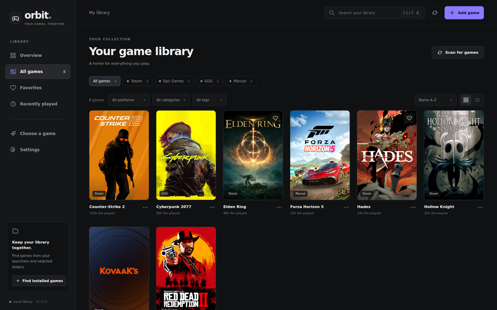

# Orbit — Game Launcher

Orbit is a local-first Electron desktop launcher. Keep installed games in one fast library, find something to play, and open it through its own launcher or a verified executable. Your library, preferences, artwork and play history stay on your computer.



The screenshot uses a sample library with public Steam artwork. It does not show a user's installed games or measured play history.

## Run from source

Use Node.js **22.13 or newer** and npm:

```bash
npm ci
npm start
```

Use `npm run dev` to enable development tools. Windows 10/11, desktop Linux and modern macOS are intended targets; actual storefront integration still needs smoke testing on the target OS. See [verification and limits](docs/VERIFICATION-v0.10.0.md).

## What's new in 0.10.0

- A quieter charcoal interface, game-led dashboard, separate landscape hero artwork, compact continue-playing cards and readable portrait covers.
- Platform filters with counts, visible active filters, grid/list views, favorites, tags, categories, sorting, and Ctrl/Cmd+K search.
- Clear pending-launch feedback and protection against repeated clicks. **Choose a game** suggests an existing library game and opens its details before launching.
- A scan report showing which metadata providers completed, their candidate counts, warnings and timing. Preview discoveries and select the games to import.
- More Steam locations, correct Epic catalog launch identities, Heroic/Legendary metadata, nested game executables, and conservative EA/Ubisoft/Blizzard registry detection on Windows.
- Shared, bounded artwork work. Repeated lookups are coalesced, missing art is briefly cached, local icon work stays separate from network work, and stale responses cannot overwrite a game edited while loading.
- A reproducible dependency lock and pull-request Windows installer/portable build artifacts.

## Find your games

Choose **Find installed games** or **Scan for games**, review the results, then import the selected entries. Orbit does not execute a discovered game during scanning.

| Provider | Metadata used | Requirements and limits |
| --- | --- | --- |
| Steam | App manifests, declared libraries, standard/native/Flatpak locations, Windows Steam registry | A verified installation folder and an installed manifest state; supported on Windows/macOS/Linux |
| Epic Games Launcher | Installed `.item` manifests | Windows; uses namespace, catalog item and app name when available; incomplete installs and DLC are excluded |
| GOG | `goggame-*.info` and Windows GOG registry | A contained, platform-appropriate executable; installers and utility targets are rejected |
| Heroic | Installed Epic/Legendary and GOG metadata, including Linux Flatpak config | Heroic must be installed and own its launch URI handler; runtime/authentication is handed back to Heroic |
| Standalone Legendary | `installed.json` | A verified native executable; Windows/Wine games on Linux/macOS without Heroic need manual setup; no Epic client is assumed |
| EA / Ubisoft / Battle.net | Windows uninstall registry | Exact recognized publisher, real installation directory and contained game EXE; records without credible executable metadata are skipped |
| Selected folders | Bounded scans of user-selected directories, including Binaries/Win64-style layouts | Installers, crash tools and symlink cycles are skipped; ambiguous executables require manual selection; macOS app bundles stay separate |

A scan is bounded. If a folder hits its entry limit, choose a smaller game-library folder and rescan. Zero candidates means no usable installed records were found at the supported locations; it does not prove that the launcher is absent. Xbox/Microsoft Store protected packages and other unsupported stores can be added manually when they provide a suitable launch target.

**Downloads is never scanned automatically.** To add a standalone game, use **Add game → Browse**, or explicitly select its game-library folder in Settings. The optional **Scan at startup** setting imports new verified candidates at startup; it is off by default.

## Artwork

Portrait covers and landscape banners are kept separate. Wide store headers never become stretched portrait covers; missing/broken art falls back to a small game icon and readable title.

Orbit reads local Steam cache images and executable icons without requiring a network connection. When **Steam artwork** is enabled, public Steam metadata/art and exact-title matching can fill missing artwork, including recognized games from other stores. No API key is needed. The setting controls online requests, not local cache access. Artwork requests send app IDs or title searches to Steam, never executable files or installation paths.

Use **Settings → Repair library covers** to explicitly retry missing or malformed art. Valid portraits are preserved. Add/Edit Game also lets you choose or clear a cover, banner and icon, or find a cover by its exact title. A delisted or unmatched title may still require manually selected artwork.

## Launching and play time

Storefront URIs require the appropriate installed game client. Direct executables are started with argument arrays and no shell; advanced launch arguments use a JSON array, such as `["--fullscreen"]`. Orbit does not install, modify or inject into games.

Direct-process sessions track time until their process exits. Windows can also detect running Steam/Epic game processes within known installation directories. A launcher wrapper that exits before its child game, an unrecognized vendor runtime or an external URI on other operating systems may not yield accurate tracked time; Orbit does not invent play history.

Use **Enter/Space** to open a focused game, **Tab** to move between controls, **Escape** to close dialogs and **Ctrl/Cmd+K** to search. Light, dark and system themes, six accents, keyboard focus and both OS/app reduced-motion settings remain supported.

## Data and backup

**Settings → Open folder** shows the local SQLite database and artwork cache. Existing libraries are opened in place, including the prior icon-column migration. This upgrade does not change the database format or replace user libraries.

Export a portable **`.orbit` backup** to include metadata, settings and local artwork, or choose **JSON** for metadata only. Restore preserves favorites, tags, dates and tracked time; existing duplicates are skipped. It does not uninstall games or overwrite existing entries. Paths still refer to the original machine and may need editing after a move. Portable backups cap embedded artwork at 100 MB and the compressed archive at 128 MB.

No account, analytics, credential scraping or game-binary upload is used. Games remain in their original locations. Steam artwork is optional; the local library and direct-game launch paths work offline, subject to each game's own requirements.

## Build and check

```bash
npm run check
npm test
npm run lint
npm run bench
npm run bench:tracking
npm run test:renderer
npm run dist:win
npm run dist:mac
npm run dist:linux
```

The optional renderer suite needs Playwright and an installed Chrome. It accepts `ORBIT_PLAYWRIGHT_PATH`, `ORBIT_BROWSER_CHANNEL`, `ORBIT_BROWSER_EXECUTABLE` and `ORBIT_QA_OUTPUT` for existing/shared installations. Its IPC is mocked; it does not launch real games. The extended interactive regression suite is `npm run test:experience` and uses the same browser variables.

Build on the target OS. GitHub pull requests run a Windows installer/portable build and attach the two EXEs as an artifact; PR builds do not publish releases. Existing main-branch/manual Windows build behavior retains private prereleases. Unsigned installers may be subject to the OS's normal verification prompts.

## Troubleshooting

- **A game is missing:** inspect the scan diagnostics, connect the installation drive, add its actual library folder, or choose its executable manually. Custom store locations outside the known metadata roots may need manual setup.
- **A scan stops early:** use a smaller library folder rather than selecting an entire drive.
- **A cover is missing:** use Repair library covers, check the artwork setting, or choose a portrait manually. Cached local art works offline.
- **A game fails to open:** confirm its store client is installed or edit the executable/working directory. Game-specific authentication, launch arguments or runtimes remain the game's responsibility.
- **Time is not increasing:** check whether the game uses an external launcher or a wrapper process; see the tracking limitations above.
- **Startup cannot open the database:** Orbit reports the data location without deleting it. Back up that directory before making any manual repairs.

## License

MIT; see [LICENSE](LICENSE). Game names and artwork belong to their respective owners.
