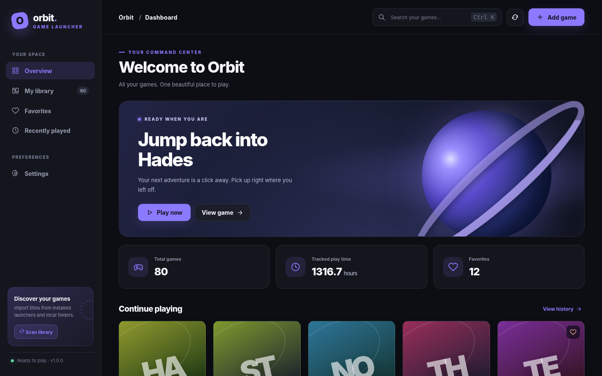

# Orbit — Game Launcher

Orbit is a local-first desktop game launcher for Windows, macOS, and Linux. It provides one fast library for games discovered in installed stores or added manually, with a polished interface, quick search, tags, filters, favorites, cover art, play actions, and optional play-time tracking.



## Requirements

- Node.js 22.13 or newer and npm for development.
- Electron 38 or newer (installed by npm).
- Windows 10/11, modern macOS, or desktop Linux. Native builds have **not** been validated on all three platforms yet.
- Internet access only for installing dependencies and, optionally, fetching Steam cover art. Running the launcher and the local library require no account or network.

## Run from source

```bash
npm install
npm start
```

During development, use `npm run dev` to enable Chromium development tools. The app reads/writes its library in Electron's per-user `userData` directory. The Settings page can open this directory directly.

## Build installers

```bash
npm run dist:win    # Windows: NSIS installer and portable executable
npm run dist:mac    # macOS: DMG and ZIP
npm run dist:linux  # Linux: AppImage and .deb
```

For best results build on the target operating system. macOS Gatekeeper distribution requires appropriate signing/notarization; Windows installer signing is optional but recommended for public release. A package build must be tested on its target OS before being considered supported.

## Features

- **Dashboard:** highlighted game, continue playing, library count, favorites and tracked play time.
- **Library:** grid and compact list, virtualized scrolling, instant search, sorting by name/recent/added/time, filters by platform, genre and tags.
- **Game details:** cover, launch action, source, tags, favorites, play time, location, quick edit/remove.
- **Custom games:** click **Add game → Browse .exe** to select an existing local game executable. Orbit fills an empty title and working directory, recognizes common abbreviated filenames such as `hoi4.exe` → **Hearts of Iron IV**, checks nearby artwork files, and extracts an executable icon where supported. On Windows, Orbit also attempts to read the executable’s built-in product name without running it. You can replace or clear images manually, enter a supported launcher URI, and configure launch arguments, tags and genre. Orbit stores the executable path; it never uploads or copies the game binary.
- **Discovery:** Steam manifest and multi-library discovery on Windows/macOS/Linux; Epic Games launcher `.item` manifests on Windows; GOG metadata (`goggame-*.info`) and Windows registry entries; optional filesystem scans of user-selected locations.
- **Control:** paginated scan preview with checkboxes and persistent selection across pages (up to 10,000 per import), duplicate detection across storefront IDs, executable paths and launcher URIs, error/warning feedback, automatic scanning on launch if enabled.
- **Persistence:** SQLite database (Node's built-in `node:sqlite`), WAL journaling, serialized settings, sessions, metadata, and art files.
- **Art:** automatically checks game folders for named cover images and asks the OS to extract an executable icon (best supported on Windows). Cover artwork takes priority; the square icon is displayed neatly against the gradient when no cover exists. Manually choose/clear PNG/JPEG/WebP cover, banner or icon images. Recognized standalone games and Steam imports can optionally download public Steam cover images. Click **Find online cover by title** in the Add/Edit Game dialog to search for an exact match to any title; no Steam account or installation is required. Artwork is stored locally and repeated selections reuse identical files.
- **Appearance:** light/dark/system theme, six accent colors, reduced-motion setting, responsive layouts, keyboard navigation and a Ctrl/Cmd+K search shortcut.
- **Privacy:** no accounts, analytics, injected game code or credential scraping. Paths and arguments are passed as discrete executable arguments without a shell. Images are served only from Orbit's own artwork directory.
- **Backup:** by default, export a compressed **`.orbit` portable backup** with game metadata, settings, and local cover/banner/icon files embedded. Restore it on another computer without separately copying artwork. Orbit also imports and exports legacy **`.json` metadata-only** backups, which do not include images. Imported games retain favorites, tags, dates, and tracked play time; existing duplicate library entries are skipped. Restores never uninstall games or overwrite existing library entries. Portable backups cap embedded artwork at 100 MB and compressed archives at 128 MB; invalid/missing artwork is reported, and you can export metadata-only JSON if your artwork exceeds the limit. Executable paths are still tied to their original computer; edit them after migrating games between devices.

## Import and compatibility details

| Source | Automatic discovery | Launch behavior |
| --- | --- | --- |
| Steam | `steamapps/appmanifest_*.acf` and `libraryfolders.vdf` | Opens Steam `steam://rungameid/<appid>` URI |
| Epic Games | Windows `.item` files from launcher manifests | Opens Epic's game-launch link; executable stored when identifiable |
| GOG | GOG `.info` files, Windows registry | Launches discovered direct executable when available |
| Custom folders | Executables and `.info` files in folders you explicitly add | Launches executable directly |
| Manual | Any executable path or supported launcher URI | Direct process or OS-registered URI |

Other launcher URI schemes include Heroic, Ubisoft, EA and Battle.net as **manual links only**; whether these work depends on which OS handlers a launcher has registered. Unsupported game stores should be added manually. Orbit does not claim account-based store synchronization or remote ownership discovery.

**Play-time accuracy:** The app tracks a directly spawned process for as long as Orbit remains open. Games that immediately hand off to another executable and close, Steam/Epic/other URI-based launching, and macOS `.app` bundles cannot be tracked reliably; Orbit marks those launch methods untracked. Do not interpret the play-time total as a complete historical record.

## Shortcuts

- `Ctrl+K` / `Cmd+K` — focus search.
- `Esc` — close dialogs.
- `Tab`, `Shift+Tab`, `Enter` — keyboard navigation.

## Tests

```bash
npm run check
npm test
npm run bench       # optional synthetic 5,000-game DB and 1,020-file scan benchmark
```

Tests cover SQLite data integrity, settings across restarts, favorite/edit/remove actions, tracked sessions, malformed data, Steam/Epic/GOG parsing, missing manifests, and safe URI/process launch behavior.

For an **optional mocked-renderer** smoke test on a machine with Python, Playwright and Chromium installed:

```bash
python tests/renderer-smoke.py
```

The renderer smoke test injects mock IPC responses into headless Chromium. It tests navigation, add/edit flows, search, settings, imports, virtualization, and scrolling. **This is not an Electron/native end-to-end test**; actual OS launchers, file dialogs, path permissions and installer packaging need a target-system test.

On a **Linux** test machine with Python Playwright and `/usr/bin/chromium` installed, a deeper browser workflow test drives the actual Electron main-process IPC handlers and SQLite storage through an Electron host stand-in:

```bash
python tests/workflow-integration.py
# With Xvfb installed, run headful Chromium:
xvfb-run -a env ORBIT_HEADFUL=1 python tests/workflow-integration.py
```

This test performs a safe local script launch, scans Steam/GOG fixtures, tests game add/edit/favorite/remove, backup, error messages, settings and persistence across backend restarts. It still **does not run a native Electron binary** or exercise real system file dialogs. See STAGE3-VERIFICATION.md.

## Architecture

```text
src/
  main.cjs            Electron entry point, IPC and native dialogs
  preload.cjs         Explicit, sandboxed renderer API
  core/
    artwork.cjs       Bounded Steam cover-image streaming
    game-file.cjs     Local executable inspection and nearby artwork detection
    game-identity.cjs Common game aliases and Windows file product-name detection
    steam-search.cjs  Exact public Steam title search with bounded responses
    backup.cjs        Portable compressed backups and safe artwork restore
    database.cjs      SQLite library and settings
    discovery.cjs     Steam/Epic/GOG/folder importers
    launch.cjs        URI validation and shell-free process launch
  ui/
    index.html        Offline UI document with strict CSP
    styles.css        Complete dark/light visual system
    app.js            Application state, routing, UI and virtual grid
assets/
  icon.png, icon.ico  App identity and packaging assets
tests/
  *.test.cjs          Built-in Node test runner suites
  renderer-smoke.py   Optional headless UI exercise
```

## Current verification

See [GAME-RECOGNITION-UPDATE.md](GAME-RECOGNITION-UPDATE.md) for the executable title recognition update with **51 passing backend tests**; see [EXE-ARTWORK-UPDATE.md](EXE-ARTWORK-UPDATE.md) for the earlier local artwork update; see [IMPROVEMENT-VERIFICATION.md](IMPROVEMENT-VERIFICATION.md) for the earlier audit. The Stage 5 baseline is recorded in [FINAL-VERIFICATION.md](FINAL-VERIFICATION.md), [STAGE3-VERIFICATION.md](STAGE3-VERIFICATION.md) for handler-backed workflows, and [STAGE4-VERIFICATION.md](STAGE4-VERIFICATION.md) for performance measurements. Native Electron and cross-platform checks remain outstanding.

## Limitations and next release checks

- Game-specific installation formats vary by storefront version. Installation manifest parsing is best effort, with the manual entry and custom folder scan as fallbacks.
- Online cover search uses Steam’s public title search and image servers when the Steam artwork setting is enabled. Only exact title matches are accepted, and not all games appear on Steam. Offline titles and covers/icons remain usable. Unknown executable names can be edited manually. Windows product-name reading and native icon extraction still require testing in a real Windows Electron build.
- macOS bundle launch commands and Windows-specific store paths are implemented, but production app builds and genuine game launches **need testing on those operating systems**.
- The Electron package and installer could not be fetched or built in the authoring sandbox (registry access unavailable during the improvement pass). `node --check`, Node integration tests, and a mocked Chromium UI smoke test were run successfully instead.
- Large library results are virtualized; user-supplied folder scanning is bounded in file count and depth.

## Security choices

The Electron renderer has no Node access, uses context isolation and a limited preload API, and cannot navigate to arbitrary pages. Launch links are scheme allowlisted. Local artwork is validated, size-limited and kept under the app's artwork directory. File and game process launch arguments never pass through a command shell. Scanning does not read game credentials or authenticate to launchers.
