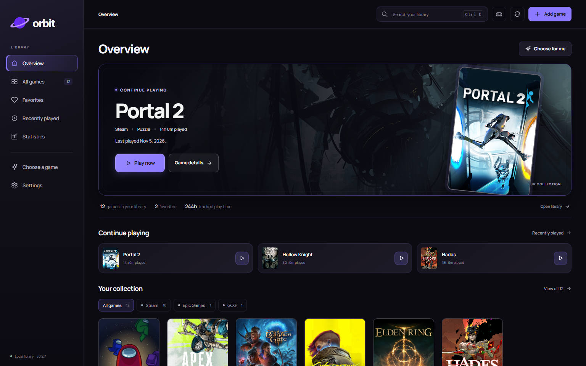
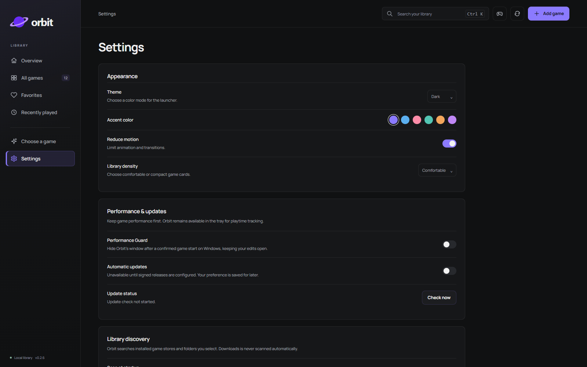

# Orbit Game Launcher

**Your games. One library. Less clutter.**

Orbit is a local-first desktop game launcher for finding, organizing, and playing installed games. It brings games from different storefronts into one library without replacing their launchers or moving their files.

The main desktop application uses **Electron**. A separate, **experimental Rust + Tauri 2 preview** is available for Windows. Both use Orbit's familiar interface; the Rust preview is not yet a production replacement.


> Screenshots use a sample library, public artwork, and simulated playtime. They are UI previews, not measurements of a real gaming session.

## What Orbit can do

- **One game library:** discover installed games, add standalone executables, and organize entries with favorites, tags, categories, and filters.
- **Find games quickly:** search with `Ctrl/Cmd + K`, sort the library, and switch between grid and list views.
- **Launch through the right client:** use a game's storefront URI or a validated executable, without moving or modifying game installations.
- **Track playtime:** record supported direct-launch sessions and detect certain externally launched games on Windows. Tracking accuracy depends on how a game starts and which processes can be identified.
- **Show game artwork:** use cached covers and icons offline, optionally look up online artwork, or select your own cover, banner, and icon.
- **Play with a controller:** use a fullscreen, gamepad-friendly library with keyboard and mouse fallback.
- **Keep your data local:** store games, settings, and play history in SQLite; export and restore library backups.

<table>
<tr><td></td><td></td></tr>
</table>

## Current editions

| | Electron desktop | Rust / Tauri preview |
| --- | --- | --- |
| Version in this repository | **0.2.6** | **0.2.5** |
| Status | Main desktop implementation | Experimental Windows preview |
| UI | Orbit HTML/CSS/JavaScript | The same interface, hosted in WebView2 |
| Backend | Node.js/Electron, with a native Windows process helper | Rust for library, discovery, tracking, artwork, and backups |
| Windows packaging | NSIS setup and portable EXE | NSIS setup, MSI, and portable EXE |
| Game tracking in the tray | Continues while the Electron window is hidden | Rust keeps running while the WebView2 window is destroyed on close |

The editions have **different application IDs and data directories**. On first launch, the Rust preview can make a snapshot of an existing Electron library and copy compatible artwork without modifying the original database. Changes made later in one edition do not automatically sync to the other.

### Memory usage (maintainer observations)

| Edition / state | Reported RAM |
| --- | ---: |
| Earlier Electron edition, with its UI open | **~300 MB** |
| Rust / Tauri preview, UI open | **~130–180 MB** |
| Rust tracking playtime while gaming, UI closed to tray | **~5 MB** |

Compared with the earlier ~300 MB Electron observation, **130–180 MB with the Tauri window open is approximately 40–57% lower**. This is an *informal comparison*, not a repeatable benchmark: the snapshots were not collected with a controlled workload and consistent process-memory metric. The ~5 MB figure refers to the reported lightweight Rust **tracking/background state**, and must not be confused with the open UI or assumed to include every shared WebView2 process. A visible Tauri window runs WebView2 renderer/GPU processes; looking at the Rust parent alone significantly understates the total.

Closing the Rust preview to the tray now destroys its WebView2 window while native game tracking continues. The window-destruction and Rust-process-survival test passed on Windows; the **complete standalone process-tree RAM delta**, tray reopening, and uninterrupted real-game playtime still need end-to-end verification. Artwork uses lazy loading, and Orbit avoids loading a redundant icon behind a valid cover to reduce unnecessary image work. No fixed additional RAM reduction is claimed for those optimizations.

See [Rust migration](docs/TAURI-MIGRATION.md) and [tray verification](docs/VERIFICATION-TAURI-TRAY-WEBVIEW.md) for methodology and remaining checks.

## Run the Electron edition

Install [Node.js](https://nodejs.org/) **22.13 or newer** and npm, then:

```bash
npm ci
npm start
```

For development tools, use `npm run dev`. Windows is the primary tested desktop platform; macOS and Linux are supported build targets, but storefront integration should be tested on each target system.

## Run the Rust / Tauri preview on Windows

Install Node.js 22.13+, stable Rust with the MSVC target, Visual Studio C++ Build Tools with the Windows SDK, and Microsoft Edge WebView2.

```bash
npm ci
npm run tauri:dev
```

To create a Windows preview installer:

```bash
npm run tauri:build
```

Tauri builds place the Windows NSIS and MSI packages under `src-tauri/target/release/bundle/`. If your machine lacks the Windows native build tools, the [Tauri Windows CI workflow](https://github.com/j5bak928-a11y/orbit-game-launcher/actions/workflows/tauri-windows.yml) can compile the preview and provide build artifacts.

**This preview is unsigned and not promoted to a production release.** The separate Electron build and installed games remain unaffected. The Rust preview's close-to-tray behavior frees its UI window while retaining native tracking; use **Quit Orbit** in the tray to stop the application completely.

## Finding and launching games

Use **Find installed games** to preview discoveries before importing them, or **Add game** to select an executable manually. Orbit reads available local installation metadata where supported:

| Source | Discovery method / caveat |
| --- | --- |
| Steam | Installed app manifests and declared Steam library folders |
| Epic Games | Installed manifests on Windows |
| GOG | Local game metadata and supported Windows registry entries |
| Heroic and Legendary | Installed-game metadata where their launch handlers or executables are available |
| EA, Ubisoft, Battle.net | Conservative Windows registry detection, requiring credible install paths |
| Custom folders | Bounded scans of explicitly selected directories; ambiguous entries may need manual selection |

Discovery is read-only and does not launch games. **Downloads is not scanned automatically.** Some protected Xbox/Microsoft Store installations and games with unusual launchers may require manual setup. Optional **Scan at startup** is off by default.

Storefront entries still require their respective client and any game-specific authentication. Direct executables are launched without shell command interpolation; advanced launch arguments use a JSON array, for example `["--fullscreen"]`.

## Artwork and library organization

Orbit keeps portrait covers separate from landscape banners. It can reuse local Steam caches and executable icons without the internet. When **Online artwork** is enabled, it can also search Steam and Epic sources for supported matches.

If a cover is missing or incorrect, choose **Settings → Repair library covers**, or select artwork manually when editing the game. Automatic discovery and online lookups are bounded; some titles may need a manual cover. User-selected artwork is not meant to be overwritten by an automatic refresh.

You can customize how covers fit and align, choose library density, switch between light/dark/system themes, and use reduced-motion settings.

## Controller mode


Choose the controller button next to Search or press **F11** to enter fullscreen controller mode. Use the D-pad or left stick to navigate, **A / Cross** to select, and **B / Circle** to go back. **LB / RB** switches pages; the on-screen controls remain usable by keyboard and mouse.

Orbit uses the browser's standard gamepad mapping. Not every controller or driver has been tested; `npm run test:controller` verifies the browser-level interactions with simulated controller input.

## Your data and backups

Orbit stores its library, play history, preferences, and cached artwork locally. Use **Settings → Open folder** to find the current edition's data directory.

- **Portable `.orbit` backup:** includes library metadata, settings, and cached artwork.
- **JSON export:** library metadata without embedded artwork.
- **Restore:** imports supported entries without deleting installed games; game paths may need adjustment on a different computer.

Orbit does not require an Orbit account or upload game executables. Online artwork requests are optional. Store clients and individual games can still have their own online requirements.

## Development and verification

```bash
npm run check
npm test
npm run lint
npm run test:controller
npm run test:renderer
npm run test:experience
npm run bench
```

Renderer and experience tests use Playwright and an installed Chromium-compatible browser. They exercise simulated library data and mocked native calls; they do not prove that real games launch successfully.

Package the Electron edition on the matching operating system with `npm run dist:win`, `npm run dist:mac`, or `npm run dist:linux`. On Windows, packaged Electron builds also need the native process-inventory helper; GitHub's [Windows build workflow](https://github.com/j5bak928-a11y/orbit-game-launcher/actions/workflows/windows-build.yml) compiles it automatically. Review builds do **not** publish a release; publishing requires the explicit manual workflow option.

Windows installers are currently unsigned. Automatic update installation is disabled until trusted signing and update verification are ready. Do not treat a successful CI build as proof of real-world storefront, tracking, or controller compatibility.

For detailed validation and limits, see [controller-mode verification](docs/VERIFICATION-controller-mode.md), [Tauri migration](docs/TAURI-MIGRATION.md), and [Windows tray lifecycle tests](docs/VERIFICATION-TAURI-TRAY-WEBVIEW.md).

## Troubleshooting

- **Game not found:** check the correct installation drive and scan results, add its library folder, or browse to its executable.
- **Cover missing:** enable online artwork if desired, run **Repair library covers**, or choose a cover yourself.
- **Game won't start:** check the store client, launch URI, executable, working directory, and any game-specific requirements.
- **Playtime seems wrong:** external clients, short-lived launch wrappers, and unrecognized processes can limit tracking.
- **Database problem:** back up the app's data folder before attempting repairs; do not delete the SQLite database to troubleshoot.

## License

MIT — see [LICENSE](LICENSE). Game names, trademarks, and artwork belong to their respective owners.
