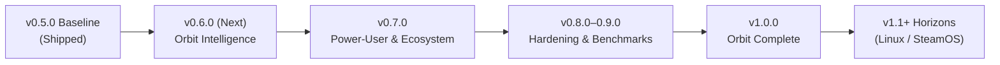

# Orbit Game Launcher — Development Roadmap (`v0.5.0` → `v1.0.0`)

**Baseline:** Orbit **`v0.5.0`** is a native **Rust + Tauri 2** desktop launcher with SQLite persistence, portable `.orbit` backups, system-tray WebView2 teardown, Ed25519-signed auto-updates (startup + GUI reopen), 5-language localization (`en`, `nl`, `de`, `fr`, `es`), play statuses, hidden games, custom collections, multi-filters, smart search operators, Bulk Action Dock, launch profiles, Xbox AppsFolder support, and **Controller Mode 2.0** (collections/status/profile parity, couch drawers, gamepad quick search, opt-in auto-entry/audio/haptics, zero idle gamepad polling).

These are **engineering milestones, not promises of public binary availability or dates**.

---

## Core Engineering Invariants (Apply to Every Release)

1. **Protect Performance:** Preserve lightweight background tracking (~5 MB tray-only reference footprint) and fast cold startup. Reject always-on background daemons, telemetry services, and unbounded disk scans.
2. **Protect User Data:** Keep SQLite as the local source of truth. Every schema addition must be non-destructive, round-trip cleanly through `.orbit` and JSON backups, and never alter or double-count historical playtime.
3. **Local-First & Zero Accounts:** All features work offline out of the box. Any online lookup (artwork, signed updates) stays opt-in or bounded with strict validation.
4. **Native Windows Fidelity:** Every feature must be verified against real Windows launcher behavior (tray lifecycle, sleep/resume, single-instance handoff, WebView2 DPI/themes), not only browser mocks.
5. **5-Language & Accessibility Parity:** Every UI string ships translated across `en`, `nl`, `de`, `fr`, `es`, respects the `>= 12px` typography floor, WCAG AA contrast in dark/light themes, keyboard navigation, and `prefers-reduced-motion`.

---

## Phase 1 — `v0.5.0`: Console Experience (Controller Mode 2.0) — *Delivered*

**Goal:** Elevate [controller-mode.js](../src/ui/controller-mode.js) into a true 10-foot couch and handheld interface with full `0.4.x` library parity and zero idle overhead.

| Workstream | Concrete Deliverables | Primary Files |
| :--- | :--- | :--- |
| **Library 0.4.x Parity** | Browse **Custom Collections**, **Play Status** shelves (`Currently Playing`, `Backlog`, `Completed`, `On Hold`), and **Alternative Launch Profiles** directly inside Controller Mode. | `src/ui/controller-mode.js`, `src/ui/controller-mode.css` |
| **Couch Action Sheet** | Dedicated controller drawer (`Y`/`Triangle` for filter/sort/collections, `X`/`Square` for status/profile picker) plus a gamepad-friendly quick-search overlay so users never need a mouse or keyboard from the couch. | `src/ui/controller-mode.js`, `src/ui/controller-input.js` |
| **Auto-Entry & Seamless Return** | Optional setting to launch directly into Controller Mode when a standard gamepad is connected; reliable post-session focus & scroll restoration across multi-monitor and fullscreen transitions. | `src-tauri/src/lib.rs`, `src/ui/app.js`, `src/ui/controller-mode.js` |
| **Tactile & Audio Feedback** | Opt-in subtle Web Audio UI navigation/launch cues (muted automatically during active gameplay) and optional short gamepad vibration pulse on launch confirmation. | `src/ui/controller-mode.js`, `src/ui/app.js` |
| **Update & Discovery Awareness** | Non-intrusive controller-mode toast/badge when a verified Orbit update is ready to install or new games are discovered, actionable with a gamepad button. | `src/ui/controller-mode.js` |

**Exit Criteria:**
- 100% keyboard + Xbox/PlayStation gamepad parity across 5,000-game virtualized views, 16:9 / 16:10 / 21:9 aspect ratios, and all 5 languages.
- Zero background gamepad polling when unfocused or when no standard gamepad is connected.

---

## Phase 2 — `v0.6.0`: Orbit Intelligence (Local Insights & Smarter Discovery)

**Goal:** Turn local SQLite history and filesystem metadata into meaningful insights and healthier libraries — 100% offline, deterministic, and private.

| Workstream | Concrete Deliverables | Primary Files |
| :--- | :--- | :--- |
| **Rich Playtime Analytics** | 12-month calendar activity heatmap, playtime breakdown by storefront/genre/status, average session length, play streaks, and CSV/JSON statistics export. | `src-tauri/src/database.rs`, `src/ui/app.js`, `src/ui/styles.css` |
| **Smart "What Should I Play?" Picker** | Upgrade `Choose for me` into a mood/context selector (*Quick session < 1h*, *Continue Currently Playing*, *Neglected Backlog*, *Unplayed Gems*, *True Random*) using pure local SQLite scoring. | `src/ui/app.js` |
| **Per-Game Notes & Rating** | Optional personal notes (mod lists, save reminders, controller tweaks) and 1–5 star personal rating stored in SQLite, searchable via `#global-search`, and preserved in `.orbit` backups. | `src-tauri/src/database.rs`, `src-tauri/src/backup.rs`, `src/ui/app.js` |
| **Library Health Check** | On-demand read-only scan flagging missing executables, moved install paths, or broken covers with one-click *Relocate executable*, *Mark Completed/Hide*, or *Remove*. | `src-tauri/src/native.rs`, `src-tauri/src/lib.rs`, `src/ui/app.js` |
| **Xbox / Packaged Store Discovery 2.0** | Expand `MicrosoftGame.config` scanning with Windows installed-package (`Appx`) metadata lookup for better Game Pass/Microsoft Store detection and optional high-res portrait artwork provider fallback (e.g., user-supplied SteamGridDB key). | `src-tauri/src/native.rs`, `src-tauri/src/artwork.rs` |

**Exit Criteria:**
- Zero external telemetry or mandatory API keys; statistics queries execute in `< 50 ms` on 10,000+ session rows.
- Full `.orbit` backup/restore round-trip tests covering notes, ratings, collections, statuses, and profiles.

---

## Phase 3 — `v0.7.0`: Power-User Controls & Ecosystem Polish

**Goal:** Solve the tricky edge cases experienced by PC gamers with heavily modded games, multi-store libraries, emulators, and multiple machines.

| Workstream | Concrete Deliverables | Primary Files |
| :--- | :--- | :--- |
| **Custom Process-Watch Rules** | Per-game override for tracked process name(s) or watch directory so games launched via mod managers, wrapper launchers, or multi-stage bootloaders always track playtime accurately. | `src-tauri/src/database.rs`, `src-tauri/src/native.rs`, `src/ui/app.js` |
| **Scheduled Local Backups** | Optional automatic `.orbit` backup rotation (daily/weekly, keep last N snapshots) to a user-chosen folder (local drive, NAS, or cloud-synced directory like OneDrive/Dropbox) with preflight verification. | `src-tauri/src/backup.rs`, `src-tauri/src/lib.rs`, `src/ui/app.js` |
| **Emulator & ROM Profiles (Opt-In)** | Reusable emulator templates (e.g. RetroArch, Dolphin, PCSX2, RPCS3) with `{rom}` argument tokens and bounded folder scanning, reusing Orbit's native launch profiles and session tracking. | `src-tauri/src/database.rs`, `src-tauri/src/native.rs`, `src/ui/app.js` |
| **Overview Personalization** | Pin custom collections or status shelves (`Currently Playing`, `Backlog`) to Overview, reorder Overview sections, custom hex accent picker, and smooth poster-scale slider. | `src/ui/app.js`, `src/ui/styles.css` |
| **Windows Shell Integration** | Windows Taskbar Jump List for quick-launching favorites/recent titles, plus optional desktop/Start Menu shortcut generator (`orbit://launch/<id>` or CLI handoff) so shortcuts still record Orbit playtime. | `src-tauri/src/tray.rs`, `src-tauri/src/lib.rs`, `src-tauri/src/native.rs` |

**Exit Criteria:**
- Custom process-watch rules verified with real multi-process launcher tests; automated backup rotation never blocks UI or corrupts existing archives.

---

## Phase 4 — `v0.8.0` – `v0.9.0`: Hardening, CI Automation & Release Verification

**Goal:** Eliminate manual release toil and empirically verify every reliability, security, and performance claim ahead of `1.0.0`.

| Workstream | Concrete Deliverables |
| :--- | :--- |
| **Automated Signed Release CI** | Enable [release.yml](../.github/workflows/release.yml) with `TAURI_SIGNING_PRIVATE_KEY` + `ENABLE_GITHUB_RELEASE_WORKFLOW=true` so tagged releases reproducibly build, test, sign `latest.json`, and publish draft GitHub Releases from clean Windows runners. |
| **Migration Compatibility Matrix** | Automated Rust integration tests migrating real fixture SQLite DBs & `.orbit` archives from `v0.2.7`, `v0.3.0`, `v0.3.6`, `v0.4.x`, `v0.5.x`, and `v0.6.x` into the latest schema with zero data loss. |
| **Repeatable Performance Suite** | Automated Windows benchmark harness built around [compare-launchers-readonly.ps1](../scripts/windows/compare-launchers-readonly.ps1) measuring cold start p50/p95, open-UI process-tree Working Set, tray-only Working Set, and 5,000-game virtual scroll smoothness. |
| **Sleep, Crash & Upgrade Drills** | Documented and scripted acceptance tests for Windows sleep/hibernate during active play, abrupt process termination, fresh install → signed auto-update → rollback, and clean uninstall. |
| **Accessibility & Community i18n** | Windows High Contrast (`forced-colors`) stylesheet audit, full screen-reader landmark/focus verification, and modularized locale tables with a contributor guide for community translations. |

---

## Phase 5 — `v1.0.0`: Orbit Complete

**Release Gate Checklist:**
- [ ] Zero known P0/P1 bugs across game launching, playtime tracking, tray teardown/reopen, backup/restore, and signed auto-updates.
- [ ] Reproducible GitHub Actions signed releases verified end-to-end (NSIS, MSI, Portable ZIP, `latest.json`, `SHA256SUMS.txt`).
- [ ] Verified schema/backup upgrade matrix from every `0.3.x+` release with zero playtime corruption.
- [ ] Published, repeatable Windows performance measurements replacing informal observations in [README.md](../README.md).
- [ ] Complete user & contributor documentation (`README.md`, `CHANGELOG.md`, `SECURITY.md`, `CONTRIBUTING.md`, troubleshooting & backup recovery guide).

---

## Post-1.0 Horizons (`v1.1+`)

- **Linux & SteamOS (Steam Deck) Native Edition:** Tauri 2 Linux build with Steam/Proton, Heroic, Lutris, and Flatpak discovery, `/proc` playtime tracking, and `gamescope`-ready Controller Mode.
- **Open-Source Authenticode Signing:** Evaluate free/open-source code signing (e.g. SignPath Foundation) to remove Windows SmartScreen warnings on fresh manual installer downloads.
- **Optional Read-Only Metadata Extensions:** Opt-in local achievement display (from Steam/GOG local files) or completion-time estimates without introducing accounts or background trackers.
